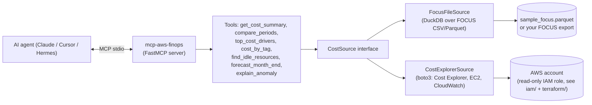

# mcp-aws-finops

[](https://github.com/thomm-011/mcp-aws-finops/actions/workflows/ci.yml)
[](https://pypi.org/project/mcp-aws-finops/)
[](https://pypi.org/project/mcp-aws-finops/)
[](LICENSE)
[](https://github.com/thomm-011/mcp-aws-finops/pkgs/container/mcp-aws-finops)

A read-only [MCP](https://modelcontextprotocol.io) server that lets an AI
agent (Claude, Cursor, Hermes…) answer AWS cost / FinOps questions directly
in plain language: *"how much did EKS cost this month?"*, *"what went up
since last month?"*, *"which resources are idle?"*.

Built on the FinOps Foundation's open **FOCUS** billing format, so it works
fully offline, with no AWS account or credentials, using bundled synthetic
sample data. An AWS Cost Explorer backend (`--source aws`) is also
available (see [AWS mode](#aws-mode)) — it has been tested against
mocked AWS APIs (botocore Stubber + moto) but **not yet validated against
a live AWS account**.


## Features

| Tool | What it does |
|---|---|
| `get_cost_summary` | Cost for a date range, grouped by service, account, region, or a tag |
| `compare_periods` | Delta between two periods and the top drivers of the change |
| `top_cost_drivers` | Rank the N most expensive services over a period |
| `cost_by_tag` | Showback by tag (e.g. `team`, `project`) incl. % untagged |
| `find_idle_resources` | Unattached EBS, idle Elastic IPs, old snapshots, low-CPU instances |
| `forecast_month_end` | Simple run-rate projection of month-end spend |
| `explain_anomaly` | What changed on a given day vs. a trailing baseline |

Also exposes one MCP **Resource** (`finops://reports/weekly`, a markdown
weekly cost report) and one MCP **Prompt** (`weekly_cost_review`).

All tools are read-only and return typed, validated (pydantic) output.
Invalid inputs (bad dates, out-of-range `n`, unknown `group_by`) raise
clear, descriptive errors instead of silently doing the wrong thing.

## Quickstart

```bash
# Once published to PyPI:
uvx mcp-aws-finops --demo

# or pip:
pip install mcp-aws-finops
mcp-aws-finops --demo

# From a checkout (works today, no PyPI release needed):
git clone https://github.com/thomm-011/mcp-aws-finops
cd mcp-aws-finops
uv run mcp-aws-finops --demo
```

### Docker

```bash
docker run -i --rm ghcr.io/thomm-011/mcp-aws-finops --demo

# AWS mode: mount read-only AWS credentials and pick a profile
docker run -i --rm \
  -v ~/.aws:/home/app/.aws:ro -e AWS_PROFILE=my-profile \
  ghcr.io/thomm-011/mcp-aws-finops --source aws --region us-east-1
```

`--demo` uses the bundled synthetic sample dataset (~3 months of AWS
billing data, see [Sample data](#sample-data)). To point it at your own
FOCUS-format export instead:

```bash
uv run mcp-aws-finops --data /path/to/focus.parquet
# or a directory of FOCUS CSV/Parquet files
uv run mcp-aws-finops --data /path/to/focus-exports/
```

The server speaks MCP over **stdio** by default.

### Claude Desktop

Add to `claude_desktop_config.json`:

```json
{
  "mcpServers": {
    "aws-finops": {
      "command": "uvx",
      "args": ["mcp-aws-finops", "--demo"]
    }
  }
}
```

### Cursor

Add to `.cursor/mcp.json`:

```json
{
  "mcpServers": {
    "aws-finops": {
      "command": "uvx",
      "args": ["mcp-aws-finops", "--demo"]
    }
  }
}
```

### Hermes

```json
{
  "mcpServers": {
    "aws-finops": {
      "command": "uv",
      "args": ["run", "--directory", "/path/to/mcp-aws-finops", "mcp-aws-finops", "--demo"]
    }
  }
}
```

## Use with your agent

Ready-to-copy configs for Claude Desktop, Cursor, Claude Code, and Hermes
live in [`examples/`](examples/) — including the zero-install
`uvx --from git+https://github.com/thomm-011/mcp-aws-finops` command (no
PyPI release yet) and a local `uv --directory` variant. See
[`docs/demo.tape`](docs/demo.tape) for the VHS source behind the GIF above.

## AWS mode

`--source aws` swaps the bundled sample data for live AWS Cost Explorer /
EC2 / CloudWatch data, via `CostExplorerSource` (same `CostSource`
interface as `FocusFileSource`, so every tool behaves identically):

```bash
uv run mcp-aws-finops --source aws --region us-east-1 --profile my-profile
```

Flags: `--profile` (named AWS CLI profile; default credential chain if
omitted), `--region` (for `ec2`/`cloudwatch` calls — Cost Explorer itself
is a single global endpoint), `--metric` (`UnblendedCost` default, or
`AmortizedCost` to spread RI/Savings-Plan costs over time), and
`--cache-ttl-seconds` (default 300; `0` disables caching).

Credentials come from the normal boto3 chain: `--profile`, environment
variables (`AWS_ACCESS_KEY_ID`/`AWS_SECRET_ACCESS_KEY`/`AWS_SESSION_TOKEN`),
or an attached IAM role (EC2 instance profile, ECS task role, EKS IRSA).

**IAM permissions:** grant the identity running the server the read-only
policy in [`iam/policy.json`](iam/policy.json) — `ce:GetCostAndUsage`,
`ce:GetCostForecast`, `ce:GetAnomalies`, `ec2:Describe{Volumes,Addresses,
Snapshots,Instances}`, `cloudwatch:GetMetricData`/`GetMetricStatistics`.
No write/mutate action is ever granted or called; see
[`iam/README.md`](iam/README.md) for the action-by-tool mapping and
[`terraform/`](terraform/) for a module that provisions an assumable role
with this exact policy (including an OIDC/IRSA trust variant). On
`AccessDenied`/missing-credentials, the server raises a `CostExplorerError`
pointing back at this policy file.

**Cost of Cost Explorer calls:** `ce:GetCostAndUsage`/`GetCostForecast`
cost ~US$0.01 per request. `CostExplorerSource` caches responses in-memory
for `--cache-ttl-seconds` (default 300s) to avoid repeat charges for the
same query window within a short span; set it to `0` to disable caching,
or raise it for a long-running server with infrequent, repeated questions.
`ec2:Describe*` and `cloudwatch:GetMetricData` calls are free.

**Status:** `CostExplorerSource` is implemented and covered by unit and
in-process MCP integration tests against `botocore.stub.Stubber` (Cost
Explorer — moto's CE support is too partial to rely on) and `moto.mock_aws`
(EC2/CloudWatch, which moto supports well). It has **not yet been run
against a live AWS account** — treat it as implemented-and-mock-tested,
not production-validated, until that happens.

## Architecture



A single `CostSource` abstract interface (`src/mcp_aws_finops/sources/base.py`)
decouples the MCP tool layer from where the data comes from.
`FocusFileSource` loads a local FOCUS CSV/Parquet file (or directory of
files) into an in-memory DuckDB view and runs SQL aggregations for every
tool. `CostExplorerSource` implements the same interface against live
`ce`/`ec2`/`cloudwatch` AWS APIs (`--source aws`) — tested with mocks, see
[AWS mode](#aws-mode) for its current validation status. Both backends
feed the exact same 7 tools unmodified.

## Sample data

The bundled dataset (`src/mcp_aws_finops/data/sample_focus.parquet`, ~47 KB)
is **synthetic**, generated deterministically by
[`scripts/generate_sample.py`](scripts/generate_sample.py) (fixed seed,
`random.Random(42)`).

We evaluated the FinOps Foundation's public
[FOCUS-Sample-Data](https://github.com/FinOps-Open-Cost-and-Usage-Spec/FOCUS-Sample-Data)
repository first, but at the time of writing its samples are small,
multi-provider, generic examples (and have open issues about not fully
passing the FOCUS validator) rather than AWS-specific data with the
resource-level detail (unattached volumes, idle EIPs, old snapshots,
per-instance CPU) the idle-resource heuristics and anomaly tooling need. A
seeded generator gave full control over that, with a license-free, byte-
reproducible result.

It models ~3 months (92 days) of AWS billing across EC2, EKS, RDS, S3,
Lambda, CloudWatch, NAT Gateway, EBS volumes (20% deliberately unattached),
EBS snapshots (some older than 90 days), and Elastic IPs (30% idle). Tags
`team`/`project`/`env` are present on most resources, with 10-30% of
resources deliberately left untagged per service to exercise the
`cost_by_tag` untagged-% metric. Day 56 (2025-08-25) has a deliberate ~2.3x
EC2 cost spike for `explain_anomaly` to detect.

FOCUS is the open, vendor-neutral billing schema from the
[FinOps Foundation](https://www.finops.org); see the
[spec](https://github.com/FinOps-Open-Cost-and-Usage-Spec/FOCUS_Spec).
`FocusFileSource` uses the standard FOCUS columns (`BilledCost`,
`ServiceName`, `ChargePeriodStart`, `Tags`, ...) plus a few `x_`-prefixed
extension columns the spec reserves for provider/implementation-specific
data (`x_Attached`, `x_AvgCpuUtilization`, ...) — documented in
[`focus_file.py`](src/mcp_aws_finops/sources/focus_file.py).

## Security

- Every tool is **read-only**: it only ever runs `SELECT` queries against a
  local file, or read-only AWS API calls (`ce:Get*`, `ec2:Describe*`,
  `cloudwatch:GetMetric*`). No tool deletes, creates, or modifies
  anything — enforced by a server-level test that rejects any registered
  tool whose name contains a mutating verb, plus a unit test
  (`tests/test_iam_policy.py`) that asserts `iam/policy.json` grants only
  actions the code actually calls and never a write action.
- No AWS credentials are required or used in offline mode (`--demo`/`--data`).
- AWS mode (`--source aws`) requires only the read-only IAM policy in
  [`iam/policy.json`](iam/policy.json) — no `*:Create*`, `*:Delete*`, or
  `*:Put*` permissions. [`terraform/`](terraform/) provisions an assumable
  role with that exact policy, including an OIDC/IRSA trust option.
- Cost Explorer API calls cost ~US$0.01 each; `CostExplorerSource` caches
  results in-memory (configurable TTL, default 300s) to avoid repeat
  charges for the same query window.

## Roadmap

- **M1 — Skeleton** ✅ repo, `uv`, `src/` layout, FastMCP server with tools, CI (ruff/mypy/pytest), README.
- **M2 — Offline mode** ✅ `FocusFileSource` over DuckDB, all 7 tools + resource + prompt on sample data, ≥80% test coverage.
- **M3 — Agent integration** ✅ ready-to-paste configs for Claude Desktop/Cursor/Claude Code/Hermes (see [`examples/`](examples/)), demo GIF of an agent (Hermes) answering real questions against the sample data.
- **M4 — AWS backend** ✅ `CostExplorerSource` (Cost Explorer + EC2/CloudWatch) implemented and tested with `botocore.stub.Stubber`/`moto` (95%+ coverage incl. an in-process MCP tool call against a stubbed AWS source); `iam/policy.json` least-privilege policy + `terraform/` role module (`terraform fmt`/`validate`/`test` all green against a mocked provider). **Not yet validated against a live AWS account.**
- **M5 — Polish** ✅ packaging metadata + `py.typed`, multi-stage Dockerfile (non-root, published to GHCR), `release.yml` (PyPI Trusted Publishing + multi-arch Docker + GitHub Release on `v*` tags), badges, README/examples updated. See [`RELEASING.md`](RELEASING.md) for the one-time PyPI setup and how to cut a release.

## Development

```bash
uv sync --all-groups
uv run ruff check . && uv run ruff format --check .
uv run mypy src
uv run pytest --cov --cov-report=term-missing
uv run pre-commit install   # optional, runs the same checks on commit
```

Regenerate the sample dataset after changing the generator:

```bash
uv run python scripts/generate_sample.py
```

## License

MIT — see [LICENSE](LICENSE).
