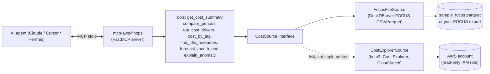

# mcp-aws-finops

A read-only [MCP](https://modelcontextprotocol.io) server that lets an AI
agent (Claude, Cursor, Hermes…) answer AWS cost / FinOps questions directly
in plain language: *"how much did EKS cost this month?"*, *"what went up
since last month?"*, *"which resources are idle?"*.

Built on the FinOps Foundation's open **FOCUS** billing format, so it works
fully offline, with no AWS account or credentials, using bundled synthetic
sample data. An AWS Cost Explorer backend is planned (see
[Roadmap](#roadmap)) but **not implemented yet** — don't point this at
production expecting live AWS data today.


## Features

| Tool | What it does |
|---|---|
| `get_cost_summary` | Cost for a date range, grouped by service, account, region, or a tag |
| `compare_periods` | Delta between two periods and the top drivers of the change |
| `top_cost_drivers` | Rank the N most expensive services over a period |
| `cost_by_tag` | Showback by tag (e.g. `team`, `project`) incl. % untagged |
| `find_idle_resources` | Unattached EBS, idle Elastic IPs, old snapshots, low-CPU instances |
| `forecast_month_end` | Simple run-rate projection of month-end spend |
| `explain_anomaly` | What changed on a given day vs. a trailing baseline |

Also exposes one MCP **Resource** (`finops://reports/weekly`, a markdown
weekly cost report) and one MCP **Prompt** (`weekly_cost_review`).

All tools are read-only and return typed, validated (pydantic) output.
Invalid inputs (bad dates, out-of-range `n`, unknown `group_by`) raise
clear, descriptive errors instead of silently doing the wrong thing.

## Quickstart

```bash
# PyPI release is pending — once published:
uvx mcp-aws-finops --demo

# Until then, run from a checkout:
git clone https://github.com/thomm-011/mcp-aws-finops
cd mcp-aws-finops
uv run mcp-aws-finops --demo
```

`--demo` uses the bundled synthetic sample dataset (~3 months of AWS
billing data, see [Sample data](#sample-data)). To point it at your own
FOCUS-format export instead:

```bash
uv run mcp-aws-finops --data /path/to/focus.parquet
# or a directory of FOCUS CSV/Parquet files
uv run mcp-aws-finops --data /path/to/focus-exports/
```

The server speaks MCP over **stdio** by default.

### Claude Desktop

Add to `claude_desktop_config.json`:

```json
{
  "mcpServers": {
    "aws-finops": {
      "command": "uvx",
      "args": ["mcp-aws-finops", "--demo"]
    }
  }
}
```

### Cursor

Add to `.cursor/mcp.json`:

```json
{
  "mcpServers": {
    "aws-finops": {
      "command": "uvx",
      "args": ["mcp-aws-finops", "--demo"]
    }
  }
}
```

### Hermes

```json
{
  "mcpServers": {
    "aws-finops": {
      "command": "uv",
      "args": ["run", "--directory", "/path/to/mcp-aws-finops", "mcp-aws-finops", "--demo"]
    }
  }
}
```

## Use with your agent

Ready-to-copy configs for Claude Desktop, Cursor, Claude Code, and Hermes
live in [`examples/`](examples/) — including the zero-install
`uvx --from git+https://github.com/thomm-011/mcp-aws-finops` command (no
PyPI release yet) and a local `uv --directory` variant. See
[`docs/demo.tape`](docs/demo.tape) for the VHS source behind the GIF above.

## Architecture



A single `CostSource` abstract interface (`src/mcp_aws_finops/sources/base.py`)
decouples the MCP tool layer from where the data comes from. Today only
`FocusFileSource` is implemented: it loads a local FOCUS CSV/Parquet file
(or directory of files) into an in-memory DuckDB view and runs SQL
aggregations for every tool. `CostExplorerSource` is declared with the same
interface, to be implemented in M4, so swapping backends needs no change to
the tools themselves.

## Sample data

The bundled dataset (`src/mcp_aws_finops/data/sample_focus.parquet`, ~47 KB)
is **synthetic**, generated deterministically by
[`scripts/generate_sample.py`](scripts/generate_sample.py) (fixed seed,
`random.Random(42)`).

We evaluated the FinOps Foundation's public
[FOCUS-Sample-Data](https://github.com/FinOps-Open-Cost-and-Usage-Spec/FOCUS-Sample-Data)
repository first, but at the time of writing its samples are small,
multi-provider, generic examples (and have open issues about not fully
passing the FOCUS validator) rather than AWS-specific data with the
resource-level detail (unattached volumes, idle EIPs, old snapshots,
per-instance CPU) the idle-resource heuristics and anomaly tooling need. A
seeded generator gave full control over that, with a license-free, byte-
reproducible result.

It models ~3 months (92 days) of AWS billing across EC2, EKS, RDS, S3,
Lambda, CloudWatch, NAT Gateway, EBS volumes (20% deliberately unattached),
EBS snapshots (some older than 90 days), and Elastic IPs (30% idle). Tags
`team`/`project`/`env` are present on most resources, with 10-30% of
resources deliberately left untagged per service to exercise the
`cost_by_tag` untagged-% metric. Day 56 (2025-08-25) has a deliberate ~2.3x
EC2 cost spike for `explain_anomaly` to detect.

FOCUS is the open, vendor-neutral billing schema from the
[FinOps Foundation](https://www.finops.org); see the
[spec](https://github.com/FinOps-Open-Cost-and-Usage-Spec/FOCUS_Spec).
`FocusFileSource` uses the standard FOCUS columns (`BilledCost`,
`ServiceName`, `ChargePeriodStart`, `Tags`, ...) plus a few `x_`-prefixed
extension columns the spec reserves for provider/implementation-specific
data (`x_Attached`, `x_AvgCpuUtilization`, ...) — documented in
[`focus_file.py`](src/mcp_aws_finops/sources/focus_file.py).

## Security

- Every tool is **read-only**: it only ever runs `SELECT` queries against a
  local file (or, once M4 lands, read-only AWS API calls). No tool deletes,
  creates, or modifies anything — enforced by a server-level test that
  rejects any registered tool whose name contains a mutating verb.
- No AWS credentials are required or used in offline mode.
- Once the Cost Explorer backend (M4) exists, it will require only a
  read-only IAM role (`ce:Get*`, `ce:Describe*`, `cloudwatch:GetMetricData`,
  `compute-optimizer:Get*`) — no `*:Create*`, `*:Delete*`, or `*:Put*`
  permissions. The exact policy JSON and a Terraform module to provision
  the role will ship with M4.
- Cost Explorer API calls cost ~US$0.01 each; the M4 implementation will
  cache results to avoid surprise bills.

## Roadmap

- **M1 — Skeleton** ✅ repo, `uv`, `src/` layout, FastMCP server with tools, CI (ruff/mypy/pytest), README.
- **M2 — Offline mode** ✅ `FocusFileSource` over DuckDB, all 7 tools + resource + prompt on sample data, ≥80% test coverage.
- **M3 — Agent integration** ✅ ready-to-paste configs for Claude Desktop/Cursor/Claude Code/Hermes (see [`examples/`](examples/)), demo GIF of an agent (Hermes) answering real questions against the sample data.
- **M4 — AWS backend** (needs an AWS account, not yet started) — `CostExplorerSource` implementation, tested with `moto`/botocore stubs, read-only IAM policy JSON, Terraform module for the role.
- **M5 — Polish** — Docker image, PyPI release (`uvx mcp-aws-finops`), badges, portfolio entry.

## Development

```bash
uv sync --all-groups
uv run ruff check . && uv run ruff format --check .
uv run mypy src
uv run pytest --cov --cov-report=term-missing
uv run pre-commit install   # optional, runs the same checks on commit
```

Regenerate the sample dataset after changing the generator:

```bash
uv run python scripts/generate_sample.py
```

## License

MIT — see [LICENSE](LICENSE).
